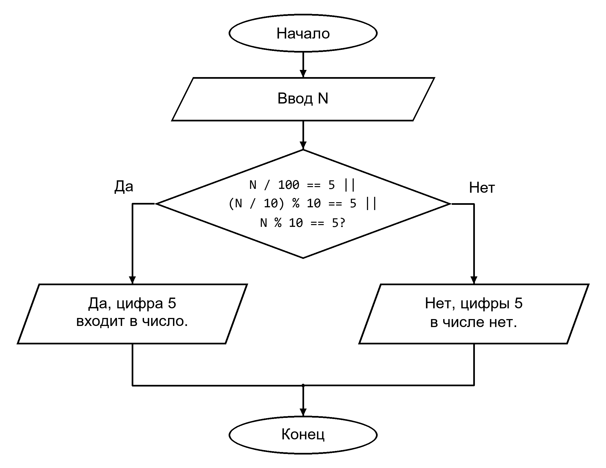

# Проверка наличия цифры 5 в числе

## Задание

Ввести целое число `N` от 0 до 999 и определить, есть ли в нём цифра 5.
## Как работает программа
1. Пользователь вводит число `N`.
2. Программа проверяет три разряда числа:
   - `N / 100` - цифра сотен;
   - `(N / 10) % 10` - цифра десятков;
   - `N % 10` - цифра единиц.
3. Знак `||` означает «или»: достаточно, чтобы хотя бы одна цифра была равна 5.
4. Если цифра найдена, выводится «Да, цифра 5 входит в число.».
   Иначе выводится «Нет, цифры 5 в числе нет.».

Целочисленное деление `/` отбрасывает дробную часть.
Операция `%` находит остаток от деления.
Программа рассчитана на числа `0 <= N < 1000`.
## Блок-схема

## Вывод

Написана программа на языке C, проверяющая наличие цифры 5 в числе.
Для проверки используется условный оператор `if-else`.
